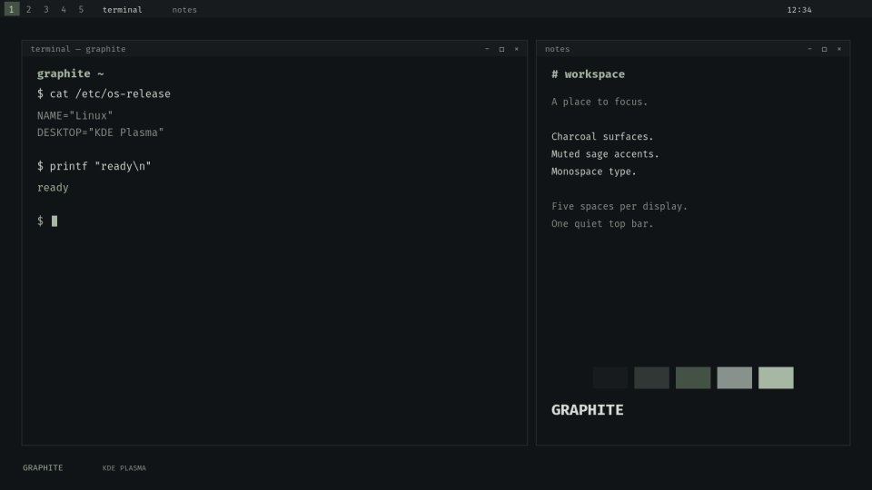

# Graphite

A minimal KDE Plasma theme and keyboard-driven desktop workflow.

Charcoal surfaces, muted sage, monospace type, Breeze decorations and contour
wallpapers. One repository and installer for supported KDE distributions; no
distribution-specific setup files.



## Use on a new machine

Download or clone this repository, open a terminal in its directory, and run
inside your KDE Plasma session as your normal user:

```sh
python3 install.py doctor install
python3 install.py install --dry-run
python3 install.py install
```

Log out and back into KDE, then verify:

```sh
python3 install.py check
```

No local settings file is required. The installer detects monitor roles, uses
KDE's default applications and falls back to installed applications where no
default is configured. Unavailable optional apps are reported and their
shortcuts skipped. It never downloads software, runs a package manager, or
needs sudo. Explicit command overrides are checked before installation.

The workflow requires Plasma 6.7+ on Wayland, one or two monitors, Python 3.10+,
PySide6 with QtDBus, libxkbcommon, Fontconfig, GDBus, kscreen-doctor, kstart,
kreadconfig6 and KDE's Plasma 5 Support QML module. Doctor checks the actual
runtime and reports missing components. Use your distribution's Python with
its KDE/Qt packages. Compiler tools and Qt development tools are not needed.

Installation applies appearance and shortcuts while preserving existing panels
and independently installed KWin scripts and their settings. The workflow
selects five independent desktops per monitor. Super+1–5 selects the primary monitor's
workspaces; Super+6–0 selects the secondary monitor's. Add Shift to move a
window. With one monitor, both banks address the same five desktops.
Conflicts with unmanaged KWin shortcut actions stop installation so their
bindings can be resolved in System Settings. See [shortcuts](docs/shortcuts.md).

## Appearance only

```sh
python3 install.py doctor theme
python3 install.py theme
```

Running `python3 install.py` also applies appearance only. It needs Plasma 6,
Python 3.10+, Fontconfig, GDBus and Breeze. It changes colors, fonts, wallpaper,
lock-screen appearance and visual effects while retaining panels, workspaces,
shortcuts and KWin scripts. No PySide6, compiler, terminal emulator or other
app is required. Missing fonts fall back to an installed monospace family.

The theme appears in System Settings → Colors & Themes → Global Theme.
A standalone archive can also be built with `python3 install.py build-theme`;
see [packaging](docs/install-options.md).

## Optional preferences

KDE's default terminal, browser, file manager and text editor are read each time
their shortcuts are used. Calculator and system monitor use installed graphical
applications. Existing defaults are never changed. No terminal profile is
installed or selected.

To override a command or disable an application shortcut, create a small
`settings.local.json`, for example:

```json
{
  "applications": {
    "Editor": ["kate"],
    "ProcessMonitor": []
  }
}
```

Pass `--settings settings.local.json` to both doctor and install. Omitted
preferences retain portable defaults; `["@default"]` restores automatic app
selection. This file is ignored by Git. Avoid copying machine-specific output
names to a new computer; empty output names enable detection. Re-run install
to enable shortcuts for optional apps added later.

## Explicit optional components

- `install --panel`: create or rebuild a top bar per display. This replaces
  widgets on existing top bars; other panels remain.
- `wheel`: build and install Super+wheel up/down workspace switching using
  existing compiler, Qt/KF6 and KWin development files. This is a native plugin;
  rebuild after KWin upgrades and log in again. No packages are installed.
- [SDDM login theme](sddm/README.md): a separate, explicitly applied system
  component requiring administrator access. Desktop installation leaves the
  login manager alone. Preview it before applying it.

Screenshot and emoji shortcuts are enabled when their tools are available.
These tools are optional for the rest of the workflow.

## Recovery and updates

Update the checkout and run the same install command again. Workflow upgrades
remove retired Graphite utility helpers and their shortcut registrations, with
backups. Independently installed KWin scripts remain untouched. Each operation
backs up its touched files under `$XDG_STATE_HOME/kde-graphite/backups/`
(default `~/.local/state`). Failed desktop writes automatically restore saved
files; a new login reloads any live KDE state already changed.

```sh
python3 install.py restore --dry-run
python3 install.py restore
```

Restore undoes the latest operation; repeated restore walks back through newer
backups to the original setup. An explicit backup path can also be supplied.
Restore replaces later edits to backed-up files. Log out and back in immediately
afterward. Backups belong to the machine where they were created; transfer the
repository and optional preferences, not installed scripts or backups.

XDG directory overrides are supported. Other desktops' configuration is
excluded, and KDE's GTK synchronization is disabled before applying colors.

See [architecture and validation limits](docs/architecture.md),
[components](docs/components.md), and [optional setup](docs/install-options.md).
Historical machine audits remain under `docs/` as evidence, not setup steps.
