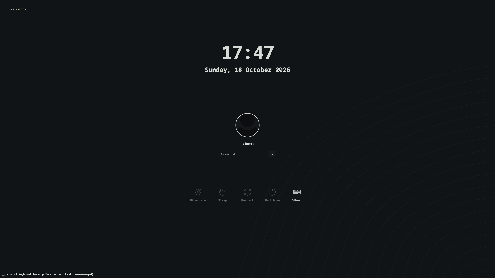

# Graphite SDDM login screen

A Graphite skin of the installed Plasma 6.8 Breeze SDDM theme: charcoal and sage,
the bundled contour wallpaper, a small wordmark and system monospace type.
The static background replaces Breeze's animated wallpaper blur. Breeze's login,
user selection, failure handling, session chooser, keyboard and power controls
are retained. This does not change PAM, autologin, users or the selected session.



Tested with Arch/CachyOS SDDM 0.21.0 and Plasma 6.8. The theme uses the KDE QML
components already installed with Plasma. No new packages or fonts are installed;
system `monospace` resolves to installed Noto Sans Mono on the audited machine.
The preview was rendered by the actual SDDM greeter in test mode.

## Preview

Run inside the desktop, without sudo:

```sh
sddm-greeter-qt6 --test-mode --theme "$PWD/sddm/graphite"
```

Close the preview to return to the desktop. Test mode does not authenticate a
session. Previewing does not select the theme for the real login screen.

## Apply explicitly

```sh
python3 sddm/install.py --dry-run
sudo python3 sddm/install.py
```

The separate installer requires root only for SDDM's system directories. The
normal Graphite desktop installer does not change SDDM. The source includes the
wallpaper locally so the greeter does not need access to your home directory.
Preflight checks the installed greeter and the Qt 6 / Plasma QML modules used
by the theme before changing system files. Older Plasma versions may lack the
Breeze components; use the desktop theme independently in that case.

The command installs root-owned readable files under
`/usr/share/sddm/themes/graphite`, selects `Current=graphite` and system monospace
in `/etc/sddm.conf.d/99-graphite.conf`, and backs up the previous contents of
those two targets under `/var/lib/kde-graphite/sddm-backups/`. The packaged Breeze
theme remains available. If a later drop-in or `/etc/sddm.conf` selects another
theme, or SDDM uses a custom theme directory, the installer reports the conflict
before making changes.

No service is restarted. The theme appears when SDDM next displays the login
screen. The test preview validates rendering, not real password authentication.

## Restore

Use the backup path printed by the installer:

```sh
sudo python3 sddm/install.py --restore /var/lib/kde-graphite/sddm-backups/BACKUP_NAME
```

Restoring also avoids restarting the display manager. The desktop profile's
`install.py restore` handles desktop backups separately from these SDDM backups.
Restore validates the backup manifest before deleting or replacing anything.
Backups from the older installer without a manifest require manual recovery.

## Source and license

The QML and fallback avatar were copied from the installed KDE Plasma 6.8 Breeze
SDDM theme. Original copyright headers remain; local modifications are the
palette, static overlay and wordmark. Upstream source:
[KDE Plasma Workspace SDDM theme](https://invent.kde.org/plasma/plasma-workspace/-/tree/Plasma/6.8/sddm-theme).
The QML is LGPL-2.0-or-later; see `LICENSE.LGPL-2.0-or-later.txt`. The Graphite
wallpaper and installer are project assets under the repository's MIT license.
